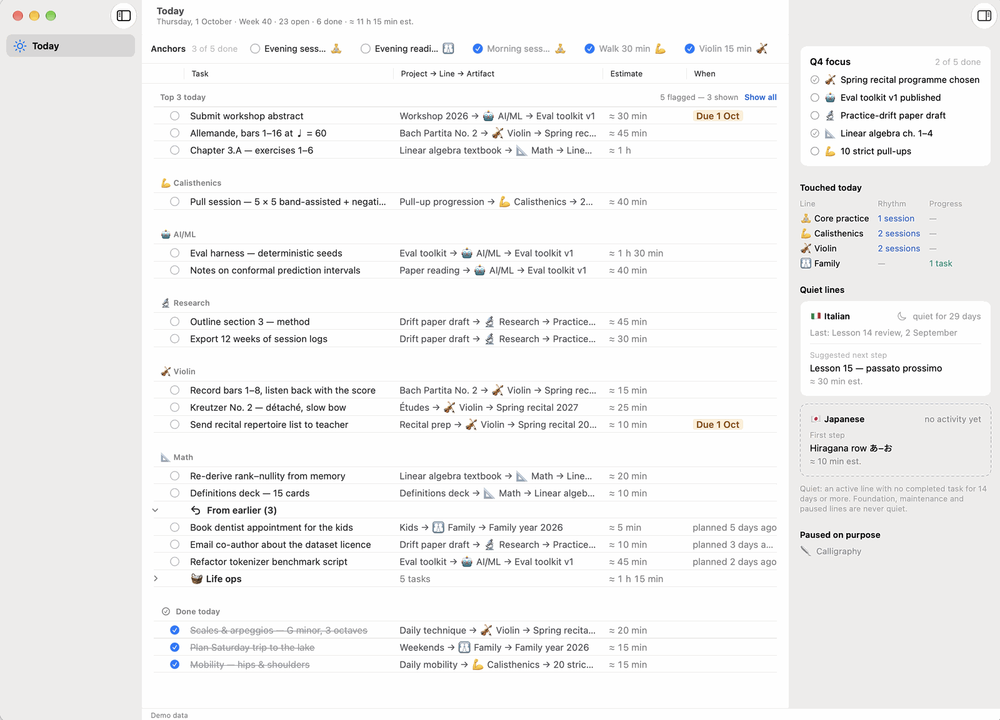
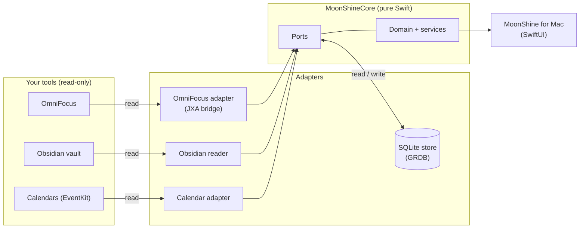

# MoonShine

[](https://github.com/Ruslan-Mz/moonshine/actions/workflows/ci.yml)

_Working name._ A macOS-first app to see, ask about and eventually run everything you plan — from today's next action to a lifetime horizon — on top of the tools you already use (OmniFocus and Obsidian today, swappable tomorrow), with an AI assistant that proposes and never silently changes anything.

It is also a worked example of **shipping through coding agents and measuring the result**: every change starts from a spec, costly decisions are ADRs, and every pull request logs its numbers.

## Vision

- **See** everything in one place at any scale, from today to a lifetime horizon, across about twenty lines of life: music, languages, maths, body, work.
- **Know if you are really progressing:** honest date ranges for any project (a violin piece, a calisthenics progression, a language course) that drift when effort slips.
- **Plan across lines:** move min / normal / max effort per project and see what fits, and when.

More in [`docs/VISION.md`](docs/VISION.md) and [`docs/ROADMAP.md`](docs/ROADMAP.md).



## Status

Phase 1, **See**: a read-only macOS app. Today runs in Demo mode on invented data, or in Live mode on the owner's OmniFocus (chosen in Settings); the Obsidian vault in Live comes next. Nothing is ever written to OmniFocus, the vault or the calendar in this phase.

## Architecture

Ports and adapters: the domain and the UI never know which tool the data came from ([`docs/ARCHITECTURE.md`](docs/ARCHITECTURE.md), [ADR-0001](docs/adr/0001-own-domain-model-with-ports-and-adapters.md)).



The store is MoonShine's own: imports write to it, and every view reads from it. Calendar events stay in memory and are never stored ([ADR-0012](docs/adr/0012-calendar-eventkit-read-only-per-device.md)).

## How this was built

Agents write the code; the owner directs and reviews. Each slice of work is planned against a spec, reviewed in a separate session, and logged with its size, review findings and time. Since 2026-10-17 a plan-critic agent also critiques the plan of every risky slice and of larger plain ones ([`CLAUDE.md`](CLAUDE.md) § Plans).

- [`CLAUDE.md`](CLAUDE.md): the rules the agents work by.
- [`docs/specs/`](docs/specs/): what each phase builds.
- [`docs/method/log.md`](docs/method/log.md): one row per pull request, with honest numbers, one file per month.
- [`docs/method/forecast.md`](docs/method/forecast.md): how slice sizes are estimated and corrected by the measured size factor.
- [`docs/method/calibration/`](docs/method/calibration/): trials of the plan critic.

## Decisions

Costly-to-reverse choices are Architecture Decision Records: the index, with each record's status, is [`docs/adr/README.md`](docs/adr/README.md).

## Build and run

Requirements: macOS 15 or newer, Xcode with Swift 6.3 or newer, and [XcodeGen](https://github.com/yonaskolb/XcodeGen) (`brew install xcodegen`).

```sh
scripts/xcbuild.sh build
```

The script checks `project.yml`, generates `MoonShine.xcodeproj` with XcodeGen, pins the package versions and runs `xcodebuild`; run XcodeGen only through it. Then open `MoonShine.xcodeproj` and run the `MoonShineMac` scheme. Demo mode works without OmniFocus or a vault. The tests: `swift test --package-path MoonShineCore`, `swift test --package-path Adapters`, and `scripts/xcbuild.sh test` for the app.

## Privacy

- Nothing from the owner's live sources (OmniFocus, the Obsidian vault, the calendar, the local data folder) is committed.
- The fixtures and the Demo data are invented.
- A local pre-push guard checks commits and pull-request texts against a private deny-list. The guard in CI runs the same commit scan on every pull request, its branch name, title and body, and every push to `main`: it keeps a match off `main` and flags it on the pull request, but it cannot keep a pushed commit off GitHub (CLAUDE.md → Commands → Guard).
- The known, accepted exceptions are listed in the PUB row of [`docs/specs/phase-1-see.md`](docs/specs/phase-1-see.md).

## Licence and contributions

Copyright © 2026 Ruslan Mozhaev. Licensed under the GNU Affero General Public License v3.0 only ([`LICENSE`](LICENSE), [ADR-0008](docs/adr/0008-license-and-distribution.md)). Issues are welcome; code contributions need a CLA, which is not offered yet ([`CONTRIBUTING.md`](CONTRIBUTING.md)).
